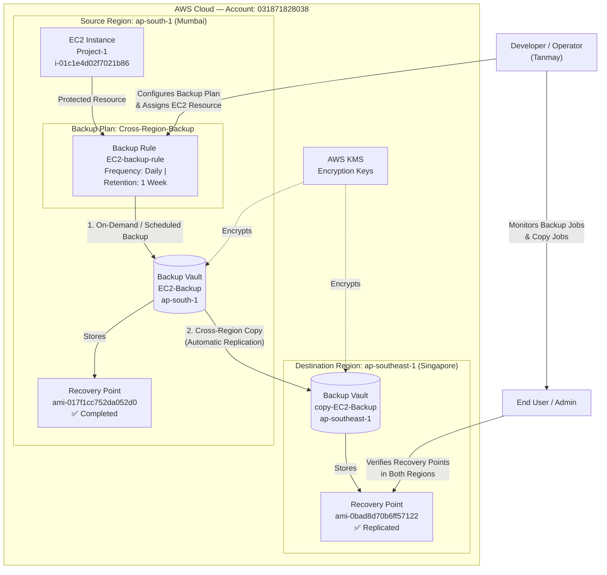

# 🛡️ Project 1 — Enable Cross-Region Backup Replication for EC2 using AWS Backup

## 📌 Objective

Configure an **AWS Backup Plan** to automatically back up an EC2 instance and replicate the backups to another AWS region, ensuring **data durability** and **disaster recovery (DR)** readiness across geographical locations.

---

## 🏗️ Architecture Overview

---

## 🚀 Project Tasks & Steps

### Step 1 — EC2 Instance Setup

- Launched an EC2 instance named **`Project-1`** in the primary region **Asia Pacific (Mumbai) `ap-south-1`**.
- Instance ID: `i-01c1e4d02f7021b86`
- Installed a basic application / uploaded sample files to verify backup integrity upon restore.

---

### Step 2 — AWS Backup Vault Creation (Source Region)

- Navigated to **AWS Backup → Vaults** in `ap-south-1`.
- Created a backup vault named **`EC2-Backup`**.
  - Vault ARN: `arn:aws:backup:ap-south-1:031871828038:backup-vault:EC2-Backup`
  - KMS Encryption enabled.
  - Created on: **August 11, 2026, 11:43:02 (UTC+05:30)**

---

### Step 3 — Backup Plan & Rule Configuration

- Navigated to **AWS Backup → Backup Plans**.
- Created a Backup Plan named **`Cross-Region-Backup`**.
- Added a Backup Rule named **`EC2-backup-rule`** with:

  | Setting             | Value          |
  |---------------------|----------------|
  | Backup Vault        | EC2-Backup     |
  | Backup Frequency    | Daily          |
  | Retention Period    | 1 Week         |
  | Cold Storage        | Not enabled    |

- Assigned the EC2 instance `Project-1` as the **protected resource** under this plan.

---

### Step 4 — Enable Cross-Region Copy (Replication)

- In the same backup rule `EC2-backup-rule`, configured the **"Copy to destination"** section:

  | Setting              | Value                        |
  |----------------------|------------------------------|
  | Destination Region   | Asia Pacific (Singapore) `ap-southeast-1` |
  | Destination Vault    | `EC2-backup-copy`            |
  | Lifecycle            | Use same settings from backup rule (1 week retention) |

- A destination vault **`copy-EC2-Backup`** was created in `ap-southeast-1`:
  - Vault ARN: `arn:aws:backup:ap-southeast-1:031871828038:backup-vault:copy-EC2-Backup`
  - Created on: **August 11, 2026, 11:44:48 (UTC+05:30)**

---

### Step 5 — Validation

- Triggered an **on-demand backup** for immediate testing.
- Verified under **Jobs → Backup Jobs**:
  - Job ID: `b610c430-622d-4ca0-bcf4-40146afb5374`
  - Status: ✅ **Completed** (Resource: `Project-1`, Type: `EC2`)
- Verified under **Jobs → Copy Jobs**:
  - Job ID: `4a4f3850-eced-43ef-9f46-a04182ebbcd6`
  - Cross-region copy status: ✅ **Completed** (Resource: `Project-1`, Type: `EC2`)
- Switched to the **Singapore region** and confirmed the destination vault `copy-EC2-Backup` contains:
  - Recovery Point: `image/ami-0bad8d70b6ff57122` — Status: ✅ **Completed**

---

## 📸 Screenshots

### 1. Backup Job — Completed (Source Region: Mumbai)
> Shows the on-demand backup job for EC2 instance `Project-1` completing successfully.

---

### 2. Source Backup Vault — `EC2-Backup` (Mumbai, ap-south-1)
> Source vault with 1 recovery point for the EC2 instance.

---

### 3. Destination Backup Vault — `copy-EC2-Backup` (Singapore, ap-southeast-1)
> Replicated recovery point visible in the destination region's vault, confirming successful cross-region replication.

---

### 4. Backup Plan Rule Configuration — `EC2-backup-rule`
> Shows the backup rule with daily frequency and the `EC2-Backup` vault selected.

---

### 5. Cross-Region Copy Settings
> Destination region set to Singapore, vault `EC2-backup-copy`, lifecycle inherited from the main backup rule.

---

### 6. Copy Job — Completed (Cross-Region Replication)
> Copy job for `Project-1` completed successfully, confirming the backup was replicated to Singapore.

---

## 📋 Summary Report

### What Was Configured

This project implemented a fully automated, cross-region EC2 backup strategy using **AWS Backup**. A backup plan named `Cross-Region-Backup` was created in the primary region (Mumbai, `ap-south-1`) with a daily backup rule targeting the EC2 instance `Project-1`. The backup rule was extended with a **cross-region copy** configuration that automatically replicates each backup to a secondary vault in Singapore (`ap-southeast-1`).

### Why Cross-Region Backup Replication?

| Benefit | Description |
|---|---|
| **Disaster Recovery** | In the event of a regional outage, backups in another region ensure business continuity and data availability. |
| **Data Durability** | Storing backups in geographically separate locations protects against data center failures, natural disasters, or region-wide incidents. |
| **Compliance** | Many regulatory frameworks (GDPR, HIPAA, ISO 27001) require offsite or geographically distributed backup copies. |
| **Reduced RTO/RPO** | Having a ready recovery point in a secondary region minimizes Recovery Time Objective (RTO) and Recovery Point Objective (RPO) during a DR event. |
| **Ransomware Protection** | Cross-region isolation ensures that a ransomware attack affecting the primary region cannot corrupt or delete the secondary backup. |

### Steps to Configure Cross-Region Backup (Summary)

1. **Create a source backup vault** in your primary AWS region.
2. **Create a backup plan** with a rule specifying frequency, vault, and retention.
3. **Assign EC2 resources** to the backup plan by tagging or direct selection.
4. **Enable "Copy to destination"** in the backup rule — select destination region and vault.
5. **Trigger an on-demand backup** to validate the setup immediately.
6. **Verify** both local and cross-region copy jobs complete successfully.
7. **Switch to the destination region** and confirm the recovery point exists in the vault.

### Issues Encountered & Resolutions

| Issue | Resolution |
|---|---|
| Destination vault did not exist initially | Created a new backup vault (`copy-EC2-Backup`) in Singapore via the "Create new vault" link directly from the backup rule editor. |
| Cross-region copy took longer than local backup | This is expected behavior — replication across regions involves additional data transfer latency. Monitored via the **Copy jobs** tab. |

---

## 🧰 AWS Services Used

- **Amazon EC2** — Virtual machine being protected
- **AWS Backup** — Centralized backup management service
- **AWS KMS** — Encryption for backup vaults
- **Amazon S3 / EBS Snapshots** — Underlying storage for EC2 recovery points (AMI-based)

---

## 📁 Project Info

| Field              | Value                                          |
|--------------------|------------------------------------------------|
| Account ID         | `031871828038`                                 |
| Source Region      | Asia Pacific (Mumbai) `ap-south-1`             |
| Destination Region | Asia Pacific (Singapore) `ap-southeast-1`      |
| EC2 Instance       | `Project-1` (`i-01c1e4d02f7021b86`)           |
| Backup Plan        | `Cross-Region-Backup`                          |
| Backup Rule        | `EC2-backup-rule`                              |
| Source Vault       | `EC2-Backup`                                   |
| Dest. Vault        | `copy-EC2-Backup`                              |
| Author             | Tanmay                                         |
